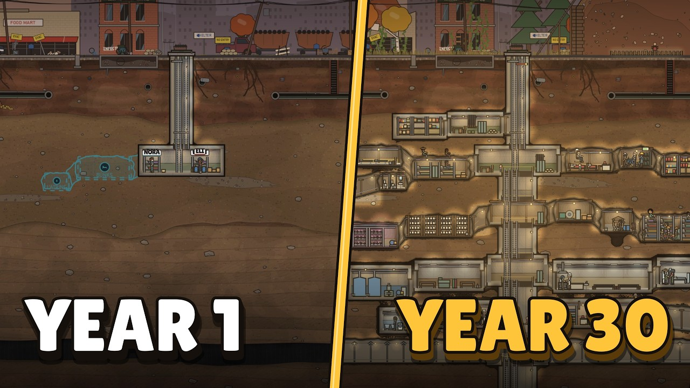

# 30 Years Underground — Zombie Apocalypse Colony Simulation

[-brightgreen.svg)]()

> Браузерный симулятор выживания колонии в постапокалиптическом бункере, созданный по мотивам 30-летней хроники выживания человечества под землёй. 4 незнакомца спасаются от бушующей орды зомби в заброшенной шахте и строят 6-ярусный автономный подземный мегаполис на глубине почти 100 метров.

---

## ⚡ Быстрый старт

Проект не требует установки Node.js, компиляции, сборщиков или установки пакетов:

1. Откройте файл [underground.html](file:///Users/Apple/Documents/GameZ/underground.html) в любом веб-браузере (Chrome, Safari, Firefox, Edge на ПК или мобильном).
2. Нажмите в любой точке экрана, чтобы активировать синтезатор звука Web Audio API.
3. Пройдите вступительный пролог или нажмите **«ПРОПУСТИТЬ ПРОЛОГ»** для перехода к симуляции колонии.

---

## 🏛️ Режимы игры и формы правления

В игру встроен переключатель режимов правления (кнопка в панели управления: `🏛️ ДЕМОКРАТИЯ ▼`):

1. **🏛️ Демократия (Совет Колонии) — *Основной режим!***
   * **Автономное строительство**: колонисты сами анализируют потребности бункера (дефицит еды, воды, жилья, обороны) и каждые несколько дней выносят на голосование постройку нужного сектора.
   * **Демократическое голосование (Council Vote)**: при возникновении кризисов и выборе проектов созывается Ассамблея Совета. Все живые колонисты (Рэй, Нора, Уолт, Элай и жители) открыто высказываются и голосуют ЗА или ПРОТИВ. Игрок голосует как гражданин наравне со всеми!
   * При одобрении проекта Уолт и шахтёры **сами находят лучшее место в шахте**, размещают чертёж и приступают к выемке породы.
2. **👑 Комендант (Прямое управление)**:
   * Единоличная власть игрока. Строительство комнат выполняется только вручную, дилеммы решаются без созыва Совета, а законы принимаются прямыми указами.
3. **⚡ Анархия (Свободная воля)**:
   * В бункере нет законов и нет Совета. Колонисты действуют импульсивно и спонтанно, строят хаотично, а мораль крайне нестабильна. Экстремальный вызов.

---

## 📋 Интерактивная Белая Доска Законов (`RULES`)

Нажав кнопку **«📋 Законы»**, игрок открывает интерактивную доску директив колонии:
1. **Норма пайков**: `Строгая экономия (0.7x еды, спасает при голоде)` / `Стандартная (1.0x)` / `Усиленный паёк (1.4x еды, +мораль)`.
2. **Комендантский час**: `Соблюдать тишину (22:00–06:00, +10 защита шлюза)` / `Круглосуточная работа`.
3. **Трудовая дисциплина**: `Добровольный труд` / `Обязательная повинность (+35% скорости строек, -мораль)`.
4. **Карантинный протокол**: `48ч изоляция Норы (0% инфекций)` / `Открытые двери`.
5. **Образование «Дети Земли»**: `Обязательная школа (+мораль родителям)` / `Помощь в штольнях (+камень)`.

*В режиме Демократии клик по закону выносит его на голосование Совета колонии! В режиме Коменданта закон утверждается мгновенно декретом.*

---

## 🎮 Ключевые возможности

* **Полная 30-летняя сюжетная линия**: 10 последовательных глав (от побега от орды до нахождения древнего *Бункера Ноль* на глубине -95 м).
* **0 зависимостей**: Написан на чистом ванильном JavaScript, HTML5 Canvas 2D и CSS3.
* **Синтезатор звука (Web Audio API)**: Процедурная генерация всех звуковых эффектов (рёв орды, удары кирки, лязг гермолюка, звуки стройки, сноса, сирены, шум лифта) без внешних mp3/wav файлов.
* **Интерактивное строительство и планирование**:
  * Ручной режим чертежей: интерактивный курсор с проверкой коллизий (зелёный/красный призрак), привязка к сетке.
  * Инструмент сноса (`💥 Снос`): демонтаж комнат и возврат 50% материалов (100% при отмене чертежа).
  * Каталог из 11 помещений: спальни, санузлы, грибные фермы, велогенераторы, помпы, лазареты, столовые, оружейные склады (`armory`), подземная школа (`school`), УФ-гидропоника (`hydro_uv`) и мастерская Рэя (`workshop`).
  * Полосы прогресса строительства на чертежах.
* **Сохранение прогресса в `localStorage`**:
  * Автосохранение каждый игровой день в полночь.
  * Кнопки **«💾 Сохранить»**, **«📂 Загрузить»** и **«🔄 Сброс»** в боковой панели HUD.
  * Сохранение выбранного режима правления (`gameMode`) и всех действующих законов (`laws`).
* **Мобильная адаптация и Touch-контроллеры**:
  * Свайп одним пальцем для перемещения карты, двухпальцевый щипок (pinch) для глубокого скролла шахты, короткий тап для взаимодействия.
  * Адаптивный выдвижной HUD-интерфейс (кнопка `📋 МЕНЮ`).

---

## 🕹️ Управление

| Действие | Управление на ПК | Мобильное управление |
| :--- | :--- | :--- |
| **Панорамирование камеры** | Зажать **ЛКМ** и перемещать мышь / `WASD` / Стрелки | **Свайп / перетаскивание одним пальцем** |
| **Глубокий скролл по шахте** | **Колесико мыши (Scroll Wheel)** | **Двухпальцевый щипок (Pinch)** / колесико |
| **Смена режима правления** | Кнопка **🏛️ ДЕМОКРАТИЯ ▼** в меню | Кнопка в выдвижном меню HUD |
| **Интерактивные законы** | Кнопка **📋 Законы** в меню | Кнопка в выдвижном меню HUD |
| **Раскопки породы** | Режим **⛏️ Копать** + клик по блоку | Режим **⛏️ Копать** + тап по блоку |
| **Размещение чертежей** | Режим **🏗️ Строить** → клик в шахте | Режим **🏗️ Строить** → тап в шахте |
| **Снос комнат / отмена** | Режим **💥 Снос** + клик по объекту | Режим **💥 Снос** + тап по объекту |
| **Сохранение / Загрузка** | Кнопки **💾 Сохранить** / **📂 Загрузить** | Кнопки в панели HUD (кнопка `📋 МЕНЮ`) |
| **Отмена режима / Пауза** | Клавиша **ESC** (отмена), **Пробел** (пауза) | Кнопка **✕ ОТМЕНА** на экране |

---

## 📁 Структура проекта

* [underground.html](file:///Users/Apple/Documents/GameZ/underground.html) — **Основной игровой файл**. Включает в себя холст рендеринга, логику демократического Совета, автосохранение, мобильный тач-движок и синтезатор звука.
* [test_all_interactions.html](file:///Users/Apple/Documents/GameZ/test_all_interactions.html) — **Автоматизированный тестовый раннер**, симулирующий последовательное переключение глав, скоростей, камер, голосований Совета, законов, размещение чертежей и мобильные жесты.
* [thumb_54mnYB2QAKY.jpg](file:///Users/Apple/Documents/GameZ/thumb_54mnYB2QAKY.jpg) — Графический референс таймлапса колонии.
* [docs/](file:///Users/Apple/Documents/GameZ/docs/) — **Подробная документация проекта**:
  * [docs/ARCHITECTURE.md](file:///Users/Apple/Documents/GameZ/docs/ARCHITECTURE.md) — Техническая архитектура, Canvas-пайплайн, аудиосинтез, `SaveSystem`, State Machine режимов.
  * [docs/GAMEPLAY.md](file:///Users/Apple/Documents/GameZ/docs/GAMEPLAY.md) — 3 режима игры, голосование Совета, законы Белой Доски, экономика 11 комнат, кризисы и оборона.
  * [docs/STORY_CHAPTERS.md](file:///Users/Apple/Documents/GameZ/docs/STORY_CHAPTERS.md) — Детальное описание всех 10 глав 30-летней хроники выживания.
  * [docs/DEV_GUIDE.md](file:///Users/Apple/Documents/GameZ/docs/DEV_GUIDE.md) — Руководство разработчика: тестирование, добавление законов, комнат, звуков и событий.
