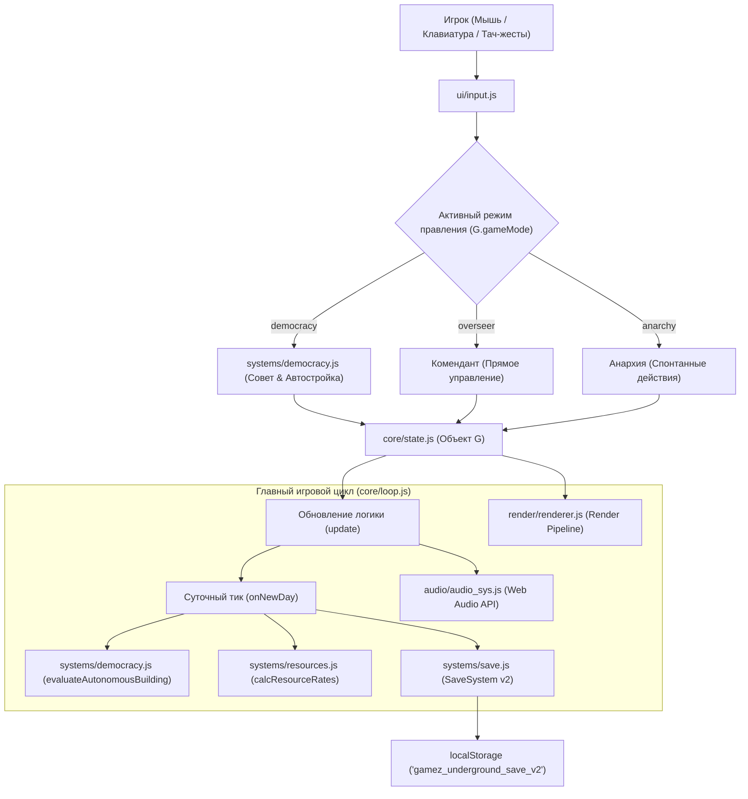

# Архитектура проекта «30 Years Underground»

Техническое руководство по модульной архитектуре на нативных ES6-модулях, шине событий `EventBus`, системе форм правления (Демократия / Комендант / Анархия), Ассамблее Совета, интерактивным законам, конвейеру рендеринга и сохранению в localStorage.

---

## 1. Общий стек и философия разработки

* **Технологический стек**: Чистый ванильный JavaScript (ES6 Modules), HTML5 Canvas 2D, Web Audio API, CSS3.
* **Зависимости**: **0 внешних зависимостей**, библиотек, фреймворков и сборщиков (Vite, Webpack, Babel не требуются).
* **Модульность**: Проект разбит на независимые функциональные слои (`core`, `world`, `entities`, `systems`, `render`, `ui`, `audio`, `styles`, `tests`).
* **Локальный сервер**: Запуск через [start.py](file:///Users/Apple/Documents/GameZ/start.py) (автоматический поиск свободного порта в диапазоне 8080–8100 и открытие браузера).



---

## 2. Организация модулей (`src/`)

### Правило слабой связанности (Decoupling)
1. **`core/state.js` и `core/constants.js`** не имеют зависимостей ни от чего.
2. **`systems/*`** меняют состояние `G` и генерируют события через `event_bus.js` (`emit('toast', ...)`, `emit('sound', ...)`). Системы **не импортируют** рендереры или модули UI.
3. **`render/*`** только читают состояние `G` и рисуют на Canvas. Никаких мутаций состояния во время отрисовки.
4. **`ui/*`** слушают события шины (`eventBus.on('hud_update', ...)`) и обновляют DOM.

```
src/
├── main.js                  # Главная точка входа (регистрация global handlers, init)
├── core/
│   ├── constants.js         # Константы карты, тайлов, цветов
│   ├── event_bus.js         # Шина событий Pub/Sub (on, off, emit)
│   ├── state.js             # Инициализация и единый объект состояния G
│   └── loop.js              # Игровой цикл, суточный тик onNewDay, elevator, time
├── world/
│   ├── grid.js              # Генерация сетки пород, пещер и шахты
│   └── rooms.js             # Каталог 11 комнат, проверка isValidPlacement, снос
├── entities/
│   └── colonists.js         # Логика перемещения колонистов, подсчет живых
├── systems/
│   ├── resources.js         # Баланс ресурсов, выработка ферм и потребление
│   ├── democracy.js         # Режимы игры, голосования Совета, автопостройка
│   ├── laws.js              # Законы Белой Доски (нормы, комендантский час, школа)
│   ├── events.js            # Случайные события, кризисы, беженцы, вылазки
│   ├── story.js             # 10 глав хроники 30 лет, пролог, гермошлюзы
│   └── save.js              # SaveSystem v2 (версионирование, автосохранение)
├── render/
│   ├── renderer.js          # Координатор рендера Canvas (shake, camera pan)
│   ├── surface.js           # Город на поверхности, выжившие, куча зомби
│   ├── underground.js       # Грунтовые слои, ствол шахты, река, лифт
│   ├── room_props.js        # Словарь ROOM_RENDERERS[r.type] для каждой комнаты
│   ├── colonist_sprites.js  # Спрайты персонажей, бейджи, костюмы, анимации
│   ├── placement_overlay.js # Призрак размещения чертежей и подсветка сноса
│   └── surveillance.js      # ЭЛТ-монитор видеонаблюдения (4 камеры)
├── ui/
│   ├── hud.js               # Обновление бокового меню HUD, миникарта, график
│   ├── modals.js            # Модальные окна (главы, стройка, решения, колонисты)
│   └── input.js             # Обработка мыши, клавиатуры (WASD) и тач-жестов
├── audio/
│   └── audio_sys.js         # Синтезатор звука Web Audio API на событиях
├── styles/
│   ├── base.css             # Базовые переменные, оверлеи прорыва, диалог
│   ├── hud.css              # Боковой HUD, полосы ресурсов, карточки людей
│   ├── modals.css           # Модальные окна глав, голосования, доски
│   └── mobile.css           # Мобильная адаптация, выдвижное меню
└── tests/
    └── test_runner.js       # Автоматический тест-раннер (?test=true, 36 тестов)
```

---

## 3. Система Сохранений (`SaveSystem v2`)

* **Ключ хранения**: `gamez_underground_save_v2` с обратной совместимостью с `gamez_underground_save_v1`.
* **Поле версии**: `version: 2` гарантирует безопасность структуры данных при обновлениях.
* **Автосохранение**: срабатывает каждый игровой день в полночь (`timeHour === 0`).
* **Сохраняемые данные**: день, часы, минуты, скорость, активная глава, камера, запасы ресурсов, колонисты с HP и статусами, комнаты, чертежи, сетка шахты, режим игры (`gameMode`), действующие законы (`laws`) и журнал событий.

---

## 4. Тестовый Раннер (`?test=true`)

Тесты изолированы в [src/tests/test_runner.js](file:///Users/Apple/Documents/GameZ/src/tests/test_runner.js) и подключаются динамически:

```javascript
const urlParams = new URLSearchParams(window.location.search);
if (urlParams.get('test') === 'true') {
  import('./tests/test_runner.js').then(m => m.runTests());
}
```

Проверяет 36 функциональных блоков симуляции (состояние, сетку, пролог, главы 1–9, режимы правления, голосование Совета, законы, размещение/снос комнат и сохранение/загрузку).
