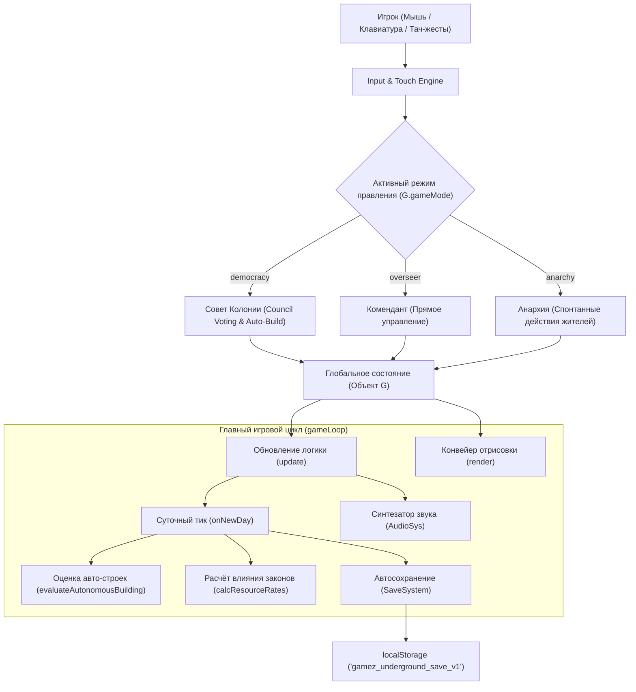

# Архитектура проекта «30 Years Underground»

Техническое руководство по внутренней структуре, системе форм правления (Демократия / Комендант / Анархия), Ассамблее Совета, интерактивным законам, конвейеру рендеринга и сохранению в localStorage.

---

## 1. Общий стек и философия разработки

* **Технологический стек**: Чистый ванильный JavaScript (ES6+), HTML5 Canvas 2D, Web Audio API, CSS3.
* **Зависимости**: **0 внешних зависимостей**, библиотек, фреймворков и сборщиков.
* **Автономность**: Запуск прямо через протокол `file://` в любом браузере на ПК, планшетах и смартфонах.



---

## 2. Глобальное состояние игры (`G`)

Все ключевые данные симуляции сгруппированы в объекте `G`:

```javascript
const G = {
  state: 'prologue',         // 'prologue' | 'game'
  day: 1,                    // Игровой день (до 10960+ дней / 30 лет)
  timeHour: 17,              // Внутриигровые часы
  timeMin: 10,               // Внутриигровые минуты
  speed: 1,                  // Множитель скорости: 1x, 2x, 5x, 30x
  toolMode: 'select',        // 'select' | 'dig' | 'place_room' | 'demolish'
  
  // ─── ФОРМА ПРАВЛЕНИЯ И ЗАКОНЫ ───
  gameMode: 'democracy',     // 'democracy' | 'overseer' | 'anarchy'
  laws: {
    rationing: 'standard',   // 'strict' (0.7x) | 'standard' (1.0x) | 'abundant' (1.4x)
    curfew: true,            // true: тишина 22:00-06:00, +10 защита | false: свободный график
    laborDuty: 'voluntary',  // 'voluntary' | 'mandatory' (+35% скорость, -мораль)
    quarantine: 'strict',    // 'strict' (0% заражения) | 'open'
    childSchool: true        // true (+мораль) | false (+камень)
  },
  lastCouncilDay: 0,
  
  placingRoom: null,         // Выбранная комната для чертежа
  hoverCell: { c: 0, r: 0 }, // Ячейка курсора на сетке
  
  res: { food: 90, water: 150, power: 100, fuel: 244, med: 10, ammo: 74, materials: 35 },
  colonists: [ ... ],
  rooms: [ ... ],            // 11 типов комнат
  blueprints: [ ... ],
  grid: [ ... ],
  mechanics: { ... }
};
```

---

## 3. Демократический движок и Совет Колонии

* **`startCouncilVote(title, prompt, optA, optB, onOptionA, onOptionB)`**:
  * Созывает Ассамблею Совета (`#council-vote-modal`).
  * Для каждого живого колониста генерируется индивидуальный голос и реплика на основе его роли, черт характера и текущей ситуации в убежище.
  * Визуализируется шкала голосов ЗА / ПРОТИВ.
  * Игрок голосует как гражданин, после чего Совет подводит итог и приводит решение в исполнение.
* **`evaluateAutonomousBuilding()`**:
  * В режиме Демократии вызывается каждые несколько дней в `onNewDay()`.
  * Анализирует потребности убежища и инициирует голосование Совета по возведению наиболее необходимой комнаты.
* **`autoPlaceRoom(roomDef)`**:
  * Проводит сканирование свободных координат вдоль ствола шахты с проверкой `isValidPlacement()`.
  * При нахождении валидной ячейки автоматически закладывает чертёж и направляет строителей на раскопки.
* **`renderWhiteboardLaws()` и `handleLawClick()`**:
  * Формируют интерактивную Белую Доску законов.
  * В Демократии клик по закону созывает Совет для пересмотра директивы.
  * В режиме Коменданта закон принимается мгновенно прямым декретом.
