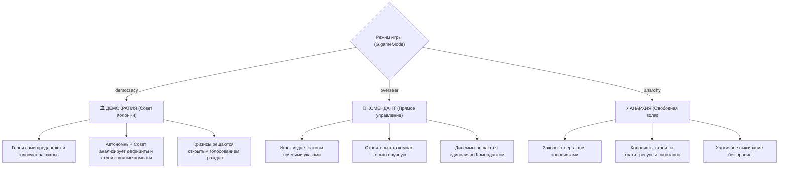
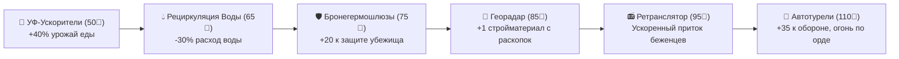
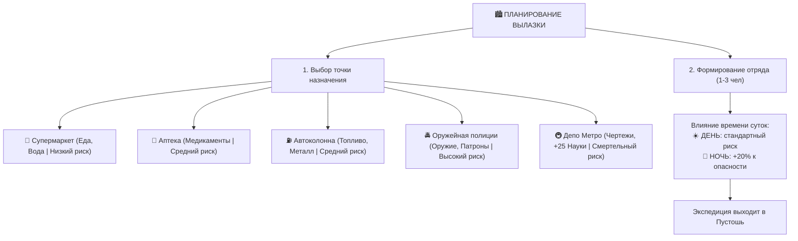

# Игровой процесс и механики симулятора «30 Years Underground»

Подробное руководство по режимам игры, демократическому Совету колонии, интерактивным законам Белой Доски, автономному строительству, экономике и выживанию.

---

## 1. Режимы игры и формы правления

В симуляторе представлены 3 принципиально разных режима управления колонией:

### 1.1. 🏛️ Демократия (Совет Колонии) — Основной режим
* **Автономное строительство**:
  * Каждые 4–8 дней (или при критической нехватке ресурсов) Совет колонии собирается на заседание.
  * Анализируются текущие запасы:
    * При дефиците еды колонисты предлагают возвести `Mushroom Farm` или `UV Hydroponics`.
    * При нехватке воды — `Water Pump`.
    * При дефиците спальных мест — жилой блок `Bunks`.
    * При угрозе штурма орды — оружейную `Armory`.
    * При вспышке инфекций — лазарет `Clinic`.
  * Совет проводит открытое голосование. При одобрении Уолт и строители **самостоятельно находят свободное место вдоль ствола шахты**, размещают чертёж и приступают к выемке грунта!
* **Ассамблея Совета (Council Voting Chamber)**:
  * В кризисных ситуациях открывается интерактивное окно Ассамблеи (`#council-vote-modal`).
  * Каждый житель бункера выступает со своей репликой и отдаёт голос:
    * **Рэй (Электрик)**: отстаивает безопасность проводки, генераторы и энергосбережение.
    * **Нора (Врач)**: ставит на первое место санитарные нормы, карантин и здоровье раненых.
    * **Уолт (Горняк)**: поддерживает расширение шахты, крепкие балки и добычу камня.
    * **Элай (Скаут)**: выступает за вылазки наружу, смелую торговлю и приём беженцев.
    * **Остальные жители**: голосуют исходя из морали и запасов провизии.
  * Игрок голосует наравне со всеми («👍 Голосую ЗА» / «👎 Голосую ПРОТИВ»).

### 1.2. 👑 Комендант (Прямое управление)
* Абсолютная власть игрока.
* Игрок единолично размещает все чертежи, отменяет стройки и принимает решения в дилеммах.
* Законы на Белой Доске принимаются и отменяются в один клик без голосований.
* Непопулярные указы (строгий паёк при полных складах или принудительный труд) вызывают рост недовольства и ускоренное падение морали.

### 1.3. ⚡ Анархия (Свободная воля)
* Отсутствие единого руководства.
* Законы не действуют (на Белой Доске надпись «NO MASTERS»).
* Колонисты действуют импульсивно: могут внезапно начать рыть породу или построить комнату по собственной прихоти.

---

## 2. Интерактивная Белая Доска Законов (`RULES`)

Нажатие кнопки **«📋 Законы»** открывает интерактивную доску действующих директив:

| Закон | Опция 1 | Опция 2 | Опция 3 | Влияние на игру |
| :--- | :--- | :--- | :--- | :--- |
| **Норма выдачи пайков** | 🥖 Строгая экономия | 🍞 Стандартный паёк | 🍖 Усиленный паёк | `strict`: расход еды `x0.7`, -5 морали (спасает при голоде). `abundant`: расход `x1.4`, +10 морали. |
| **Комендантский час** | 🌙 Соблюдать тишину (22:00–06:00) | ☀️ Круглосуточные работы | — | `curfew = true`: +10 к защите шлюза от орды, но ночью стройки приостановлены. |
| **Трудовая дисциплина** | 🛠️ Добровольный труд | ⛏️ Обязательная повинность | — | `mandatory`: +35% к скорости добычи и стройки, но колонисты устают (-1.5 морали/день). |
| **Карантинный протокол** | ☣️ 48ч изоляция Норы | 🚪 Открытые двери | — | `strict`: 0% риска занести инфекцию от чужаков. `open`: быстрое заселение, но 20% риск болезни. |
| **Образование детей** | 📚 Обязательная школа | 🎒 Трудовая помощь | — | `school = true`: +10 морали родителям, дети готовятся к профессиям. `false`: +1 материал/день. |

*В Демократии клик по закону выносит его на голосование Совета колонии! В режиме Коменданта закон утверждается мгновенно декретом.*

---

## 3. Каталог помещений (11 типов комнат)

1. **Спальный блок (Bunks / Quarters)**: `6x4`, 15 🪨. Увеличивает лимит населения колонии (`popCap +6`).
2. **Санузел (Latrine)**: `4x3`, 10 🪨. Поддерживает санитарию, снижает риск эпидемий.
3. **Грибная ферма (Mushroom Farm)**: `6x4`, 20 🪨. Выращивание грибов в корнях берез (+3 еды/день).
4. **Велогенератор (Bike Dynamo)**: `5x4`, 25 🪨. Велогенератор Рэя (+15 энергии в сутки).
5. **Водяная помпа (Water Pump)**: `5x4`, 30 🪨. Откачивает и фильтрует чистую воду (+4 воды/день).
6. **Лазарет (Clinic / Infirmary)**: `5x4`, 25 🪨. Рабочее место Норы для лечения ранений и лихорадки.
7. **Столовая и штаб (Mess Hall / Kitchen)**: `6x3`, 20 🪨. Место сбора колонии и размещения Белой Доски (+мораль).
8. **Оружейный склад (Armory)**: `5x4`, 35 🪨. Стойки с оружием (+15 к защите шлюза, хранение патронов).
9. **Подземная школа (Below School)**: `6x4`, 30 🪨. Меловая доска и парты для детей (+10% морали).
10. **УФ-гидропоника (UV Hydroponics)**: `7x4`, 45 🪨. Ультрафиолетовые стеллажи с высокой отдачей (+6 еды/день).
11. **Мастерская Рэя (Workshop)**: `5x3`, 25 🪨. Верстак, тиски и инструменты (+0.5 материала/день).

---

## 4. Сохранение прогресса (`localStorage`)

* **Автосохранение**: срабатывает автоматически каждую полночь (`onNewDay()`). Сохраняет тайлы грунта, координаты и типы всех комнат, чертежи, состояние колонистов, выбранный режим правления (`gameMode`), законы (`laws`) и изученные технологии древа науки (`research`).
* **Ручное управление**: кнопки **«💾 Сохранить»**, **«📂 Загрузить»** и **«🔄 Сброс»** в панели HUD.
* **Версионирование**: `SaveSystem` использует спецификацию версии `v2` с автоматической валидацией целостности данных.

---

## 5. Древо Технологий и Подземная Наука (`TECH_TREE`)

В игре реализована полноценная исследовательская лаборатория (`#research-modal`), доступная по кнопке **«🔬 Наука»** в правом верхнем тулбаре.

### 5.1. Генерация очков науки
* **Базовая ставка**: 1 очко науки каждые сутки.
* **Школы и мастерские**:
  * Каждая построенная Подземная школа (`School`): **+2 науки/сутки**.
  * Каждая оборудованная Мастерская (`Workshop`): **+3 науки/сутки**.
* **Специалисты колонии**:
  * Каждый живой инженер (`ENG`), электрик (`ELEC`) или техник (`TECH`) дает **+1 очко науки/сутки**.
* **Вылазки в метрополитен**:
  * Успешная экспедиция в Заброшенное Депо Метро приносит **+25 очков науки сразу**.

### 5.2. Доступные технологии

* **🌱 УФ-Ускорители Роста (50 🔬)**: Спектральная лампа полного цикла для грибных ферм и гидропоники. Увеличивает выработку пищи на +40%.
* **💧 Замкнутый Цикл Водоочистки (65 🔬)**: Керамическая ультрафильтрация сточных вод. Сокращает потребление чистой воды колонией на 30%.
* **🛡️ Усиленные Бронегермошлюзы (75 🔬)**: Титановые распорки люка поверхности. Дает постоянный бонус +20 к показателю обороны (`defenseRating`).
* **📡 Глубинный Георадар (85 🔬)**: Ультразвуковое сканирование пластов. Каждое ручное копание приносит +1 дополнительный блок стройматериалов.
* **📻 Усилитель Радиопередатчика (95 🔬)**: Сверхмощная антенна на руинах поверхности. Привлекает выживших вдвое чаще.
* **🎯 Автоматические Турели (110 🔬)**: Спаренные пулеметные гнезда в шахте. Бонус +35 к защите, автоматически отбивают прорывы мутантов.

### 5.3. Взаимодействие с режимами правления
* **Демократия**: Выбор технологии выносится на голосование Совета. Колонисты оценивают насущность проекта и утверждают его большинством голосов.
* **Комендант**: Игрок единоличным указом мгновенно назначает текущий приоритет науки.
* **Анархия**: Жители могут самовольно переключиться на другой проект, если посчитают его более интересным.

---

## 6. Тактические Вылазки на Поверхность (`SCAVENGE_DESTINATIONS`)

При нажатии на шлюз поверхности или кнопку экспедиции открывается окно планирования тактической вылазки:

### 6.1. Локации Пустоши
1. **🏪 Супермаркет «FOOD MART»**: Низкий риск (22%). Источник консервов (+35..80 🍞), чистой бутилированной воды (+25..60 💧) и базовых материалов.
2. **💊 Аптека «ЗДОРОВЬЕ»**: Средний риск (35%). Запасы антибиотиков, жгутов и обезболивающих препаратов (+15..35 💉).
3. **⛽ Заправка и Автоколонна**: Средний риск (38%). Канистры с дизелем (+30..80 ⚡), аккумуляторы и металлический лом (+20..50 🪨).
4. **🚔 Полицейский участок и Оружейная**: Высокий риск (55%). Штурмовые винтовки, бронежилеты и цинки с патронами (+20..45 🎯). Высокая вероятность встречи с мародерами.
5. **🚇 Станция метрополитена и Депо**: Смертельный риск (68%). Темные тоннели, гнезда мутантов, но бесценная научная документация: **+25 очков науки**, редкие ресурсы и чертежи.

### 6.2. Роли и специализация в экспедиции
* **Скаут (Элай)**: Врожденная маскировка снижает опасность столкновения с врагами на 50%.
* **Защита Убежища**: Чем лучше укреплен шлюз бункера (`defenseRating`), тем быстрее и безопаснее отряд отступает под прикрытие турелей.

---

## 7. Черты характера и перки колонистов (`COLONIST_PERKS`)

Каждый выживший обладает уникальной чертой характера, влияющей на жизнь бункера:

* ⚡ **Рэй — «Энергетик бункера»**: Скорость выработки велогенератора увеличена на 25%; ускоряет технические исследования.
* 🩺 **Нора — «Полевой медик»**: Снижает потребление лекарств лазаретом на 30%; предотвращает развитие эпидемий.
* ⛏️ **Уолт — «Мастер-проходчик»**: Ручная выемка породы на 50% быстрее; повышает прочность опорных балок.
* 🏹 **Элай — «Следопыт пустошей»**: Шанс попасть в засаду при вылазках на поверхность снижен в 2 раза; находит на 25% больше припасов.
* 🔧 **Инженеры / Рабочие — «Умелые руки»**: Производство стройматериалов и ремонт поврежденных гермодверей.
* 🌾 **Фермеры — «Зеленый палец»**: Урожайность гидропоники и грибниц выше на 15%.
* 🛡️ **Охранники — «Железный нерв»**: Дополнительный бонус к обороне шлюза при штурме орды.

