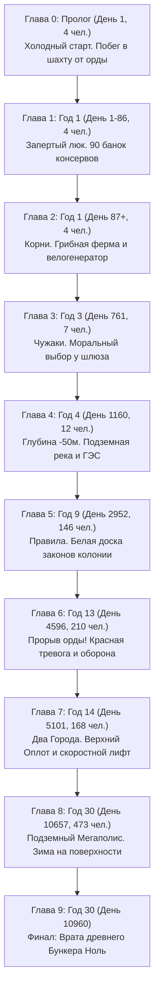

# Хронология и сюжетные главы (30 Лет Под Землей)

Полный справочник по сюжетным актам, моральным выборам, диалогам и развитию колонии на протяжении трёх десятилетий изоляции.

---

---

## Глава 0: Холодный старт (0:00 · Пролог)
* **Статус**: День 1, Популяция: 4 человека (Рэй, Нора, Уолт, Элай).
* **Сюжет**: Город охвачен пандемией и огнём. Четверо незнакомцев отбиваются от бесконечной толпы заражённых, прорываясь к заброшенной промышленной шахте на окраине.
* **Игровые события**: Динамическая анимация бегства персонажей по поверхности, нарастающий рев орды («Куча зомби»), падение в ствол и закрытие массивной гермодвери в последнюю секунду. Включение аварийного дрожания экрана (`shake`) и синтез звука удара брони.

---

## Глава 1: Запертый люк (0:40 · Год 1)
* **Статус**: День 1–80, Популяция: 4 человека, Запасы: 90 банок тушенки, 150 л воды.
* **Сюжет**: Первый ярус убежища (`Shelter 4`). В темноте мерцает аварийная лампа. Наверху круглосуточно слышно царапанье когтей зомби в стальную крышку люка.
* **Диалоги**:
  > **Рэй**: *«Рэй. Электрик. Генератор пока работает, но солярку надо беречь как зеницу ока.»*  
  > **Нора**: *«Нора. Военврач. Первое правило: строгий учет воды и никакой паники.»*  
  > **Уолт**: *«Уолт. Горняк. Дайте мне кирку, здесь крепкая порода — нужно уходить глубже.»*  
  > **Элай**: *«Элай. Курьер. Наверху остался целый город... но живыми туда уже не выйти.»*

---

## Глава 2: Корни (4:21 · Год 1)
* **Статус**: День 87, Популяция: 4 человека.
* **Сюжет**: Провизия начинает подходить к концу. Уолт пробивает боковую штольню в корневую систему старых берез.
* **Свершения**:
  * Создание первой грибной плантации на перегное корней (+2 еды/день).
  * Сборка велогенератора Рэем: ежедневные дежурства на педалях дают заряд аккумуляторам радиостанции и ламп.
  * Первые капли чистой конденсатной воды из пробуренного шурфа.

---

## Глава 3: Чужаки (7:51 · Год 3)
* **Статус**: День 761, Популяция вырастает до 7 человек.
* **Моральная дилемма**: Стук в верхний люк. Это не зомби, а семья выживших с чертежами самодельной гидропоники. Они умоляют об убежище.
* **Выбор игрока / Совета**:
  1. *Впустить чужаков*: +3 жителя, чертеж УФ-фермы, но мгновенный рост расхода еды и риск принести заразу.
  2. *Оставить запертыми*: сохранение стабильности запасов, но тяжелый удар по морали колонистов.
* **Сюжетная вставка**: Страница из рукописного дневника основателей с описанием ночных споров.

---

## Глава 4: Глубина (11:21 · Год 4)
* **Статус**: День 1160, Популяция: 12 человек, Глубина: -50 метров.
* **Сюжет**: Шахтный ствол пробивает монолитный известняк и выходит в гигантскую подземную каверну с бурной ледяной рекой.
* **Свершения**:
  * Постройка гидротурбины в потоке реки: колония получает неиссякаемый источник чистой энергии.
  * «Ночь, когда зажглись все огни» — все подземные тоннели впервые озаряются ярким электрическим светом.
  * Установка автоматических фильтрационных насосов.

---

## Глава 5: Правила (14:51 · Год 9)
* **Статус**: День 2952, Популяция: 146 человек.
* **Сюжет**: Бункер превращается в сложное социокультурное общество. Появляется второе поколение людей. Жить без законов становится невозможно.
* **Сюжетная вставка**: **Белая доска законов колонии (Whiteboard Inset)**:
  1. *Суточная норма пайка*: 1 банка белков и 1.5 литра воды на взрослого, детям — приоритет.
  2. *Комендантский час*: абсолютная тишина с 22:00 до 06:00 (любой громкий шум привлекает верхнюю орду).
  3. *Карантинный протокол*: любая лихорадка или царапина — немедленная 14-дневная изоляция в секторе Норы.

---

## Глава 6: Прорыв (18:57 · Год 13)
* **Статус**: День 4596, Популяция: 210 человек.
* **Сюжет**: Под давлением скопившейся за 13 лет миллионной кучи зомби старый входной шлюз деформируется и сминается.
* **Игровые события**:
  * Срабатывание экстренной сирены тревоги (`playSiren()`).
  * Включение пульсирующего кроваво-красного экрана (`red-alert-overlay`).
  * Героическая оборона у гермодверей: часовые отбивают первый эшелон зараженных.
  * Принятие решения о подрыве верхнего участка лестницы и герметизации верхнего яруса.

---

## Глава 7: Два Города (22:27 · Год 14)
* **Статус**: День 5101, Популяция: 168 человек (после прорыва и реорганизации).
* **Архитектурная революция**:
  * **Верхний Оплот (Upper Bastion)**: тяжело бронированная военная застава на глубине -15 метров.
  * **Нижний Город (Lower City)**: мирные жилые ярусы, фермы, детские классы на глубине от -38 до -70 метров.
  * **Скоростной моторизованный лифт**: запуск стальной клети с противовесом в стволе шахты (`G.elevator.unlocked = true`), объединяющей уровни.

---

## Глава 8: Подземный Город (26:58 · Год 30)
* **Статус**: День 10657, Популяция: 473 человека.
* **Сюжет**: На поверхности наступила затяжная постапокалиптическая зима (Canvas рендерит падающие хлопья снега и заснеженные руины). Под землёй вырос полноценный самодостаточный 6-ярусный мегаполис.
* **Инфраструктура**:
  * Подземная школа для третьего поколения («Дети Земли»).
  * Лазарет имени Норы с непрерывным производством пенициллина.
  * Ярусы УФ-гидропоники с высокими урожаями.
  * Док заброшенного тоннеля метро.

---

## Глава 9: Финал: Что таится внизу (30:18 · Год 30)
* **Статус**: День 10960 (30 лет и 10 дней с момента бегства).
* **Сюжет**: Тяжёлый бур на отметке -95 метров натыкается на аномальный титановый сплав, который не берёт ни одна алмазная коронка.
* **Финал**: Раскрытие древних массивных ворот **«Бункера Ноль» (Vault Zero)** с мигающими светодиодами автономного питания и логотипом проекта спасения человечества. Завершение эпической хроники 30 лет подземной борьбы.
